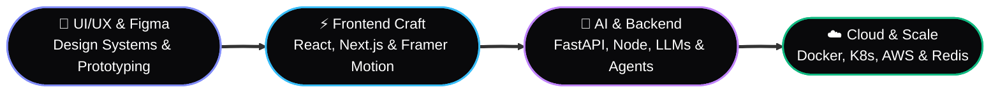

<div align="center">

  <!-- DYNAMIC ANIMATED HEADER WAVE -->
  

  <!-- ANIMATED TYPING SVG -->
  <a href="https://navanidhiram.dev">
    
  </a>

  <br/>

  <!-- SOCIAL & PORTFOLIO LINKS -->
  <p align="center">
    <a href="https://navanidhiram.dev" target="_blank">
      
    </a>
    <a href="https://navanidhiram.me" target="_blank">
      
    </a>
    <a href="https://www.linkedin.com/in/navanidhiram-a-developer" target="_blank">
      
    </a>
    <a href="https://x.com/navanidhiram007" target="_blank">
      
    </a>
    <a href="https://www.youtube.com/@navanidhiram.a" target="_blank">
      
    </a>
  </p>

  <!-- STATUS & PROFILE BADGES -->
  <p align="center">
    
    
    
    
  </p>

</div>

---

### ⚡ `$ whoami` — Product Engineer & System Architect

```zsh
navanidhiram@dev ~ % npm i navanidhiram.dev
added 1 package in 0.42s
✓ navanidhiram.dev installed.
→ ready to build something great.
```

```ts
const navanidhiram = {
  pronouns: "He" | "Him",
  location: "Tamil Nadu, India 🇮🇳",
  role: "Senior Software Engineer & Full-Stack Product Developer",
  philosophy: "Restraint is the luxury. Every line of code and every pixel should earn its place.",
  highlights: {
    yearsBuilding: "4+",
    projectsShipped: "20+",
    technologiesMastered: "29 across 5 core layers"
  },
  focusAreas: [
    "End-to-End Web Product Engineering (React / Next.js / FastAPI / Node.js)",
    "Autonomous AI Agents, RAG Pipelines & Local LLMs (CrewAI / LangChain / Ollama)",
    "High-Craft UI/UX Design Systems & Fluid Motion (Figma / Framer Motion)",
    "Cloud-Native Architecture & Workflow Automation (Docker / K8s / AWS / n8n)"
  ]
};
```

> *"I turn ideas into shipped software — from database schemas to pixel-perfect interfaces — with a relentless focus on performance, detail, and the experience in between."*

---

### 🛠️ `01 // THE STACK` — 5 Layers · 29 Technologies

<div align="center">

| Layer | Philosophy | Core Technologies |
| :--- | :--- | :--- |
| **01. Frontend** | *Interfaces that feel inevitable — fast, accessible, alive.* |      |
| **02. Backend** | *Systems that hold up — typed, tested, and observable.* |       |
| **03. AI / ML** | *From local LLMs to production ML — training, fine-tuning, agents.* |      -000000?style=flat-square&logo=llama&logoColor=white) |
| **04. DevOps & Cloud** | *From local to production — repeatable, observable, calm.* |   -232F3E?style=flat-square&logo=amazonwebservices&logoColor=FF9900)    |
| **05. Mobile & Tools** | *Android native + the tooling that keeps the craft sharp.* |      -EA4B71?style=flat-square&logo=n8n&logoColor=white) |

<br/>

<!-- ANIMATED SKILL ICONS SHOWCASE -->
<p align="center">
  
</p>

</div>

---

### 🚀 `02 // SELECTED WORK & EXPERIENCE` — A Track Record of Shipping

<table width="100%">
  <tr>
    <td width="50%" valign="top">
      <h4>🏛️ IndusLink — Internship & Industry Connect Portal</h4>
      <p><b>Excel Engineering College · Campus Innovation</b></p>
      <p>Designed and developed a dedicated web portal bridging the student–industry connect gap. Built with smart tracking, real-time analytics, and data visualization to streamline internship registrations and decision-making for students and faculty.</p>
      <p><code>Web Development</code> <code>Analytics</code> <code>Data Visualization</code></p>
    </td>
    <td width="50%" valign="top">
      <h4>💬 SuGow Innovation — Senior Software Engineer</h4>
      <p><b>Client Systems & WhatsApp CRM Architecture</b></p>
      <p>Lead technical development and strategic operations across multiple client engagements, including a specialized WhatsApp CRM for a women's skills-training platform. Architected high-throughput APIs and automated operational workflows.</p>
      <p><code>System Architecture</code> <code>CRM</code> <code>Full-Stack</code> <code>Automation</code></p>
    </td>
  </tr>
  <tr>
    <td width="50%" valign="top">
      <h4>♿ Deaf Enabled Foundation (DEF) — Full-Stack Java</h4>
      <p><b>Social Impact & Accessible Web Applications</b></p>
      <p>Engineered full-stack web applications supporting the Foundation's digital initiatives across Java/Spring, REST APIs, and Angular/MEAN stack — directly improving digital accessibility for the deaf community.</p>
      <p><code>Java</code> <code>Spring</code> <code>REST APIs</code> <code>Angular</code> <code>Accessibility</code></p>
    </td>
    <td width="50%" valign="top">
      <h4>💧 Aquaman Water Purification — Digital Platform</h4>
      <p><b>End-to-End Business Web Experience</b></p>
      <p>Designed and shipped the official web presence for Aquaman Water Purification, combining high-craft product storytelling with fast, responsive frontend engineering and SEO optimization.</p>
      <p><code>UI/UX Design</code> <code>Frontend Engineering</code> <code>Performance</code></p>
    </td>
  </tr>
</table>

---

### 💎 `03 // WHAT I DO` — End-to-End Craft



---

### 📊 `04 // GITHUB TELEMETRY & ACTIVITY`

<div align="center">

  <!-- GITHUB STATS & STREAK SIDE BY SIDE -->
  
  

  <br/><br/>

  <!-- TOP LANGUAGES & ACTIVITY GRAPH -->
  

  <br/><br/>

  <!-- CONTRIBUTION GRAPH -->
  

  <br/><br/>

  <!-- ANIMATED SNAKE CONTRIBUTION EATER -->
  <picture>
    <source media="(prefers-color-scheme: dark)" srcset="https://raw.githubusercontent.com/platane/snk/output/github-contribution-grid-snake-dark.svg" />
    <source media="(prefers-color-scheme: light)" srcset="https://raw.githubusercontent.com/platane/snk/output/github-contribution-grid-snake.svg" />
    
  </picture>

</div>

---

### 💬 `05 // WHAT FOUNDERS & TEAMS SAY`

> *"Navanidhiram thinks in systems and ships in detail. He took our product from a sketch to a launch in weeks — and the codebase is one of the cleanest I've inherited."*
> — **Aarav Mehta**, Founder · Orchard

> *"Rare to find a developer who cares as much about the pixel as the query plan. The result speaks for itself — fast, beautiful, and reliable."*

---

<div align="center">

### 🤝 Let's Build Something Extraordinary Together

Whether you're launching a new product from scratch, scaling an AI workflow, or refining a design system — **I'm available for full-stack engineering, AI development, and technical consulting.**

<p align="center">
  <a href="https://navanidhiram.dev"><b>🌐 Visit Portfolio (navanidhiram.dev)</b></a> •
  <a href="https://www.linkedin.com/in/navanidhiram-a-developer"><b>💼 Connect on LinkedIn</b></a> •
  <a href="https://x.com/navanidhiram007"><b>🐦 Follow on X</b></a> •
  <a href="https://www.youtube.com/@navanidhiram.a"><b>▶️ Watch 365 Days Tech Challenge</b></a>
</p>

<!-- ANIMATED FOOTER WAVE -->


</div>
