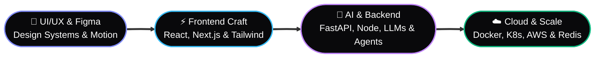

<div align="center">

<!-- 🌊 ANIMATED LIQUID WAVE HEADER -->


<!-- ⌨️ MULTI-LINE ANIMATED TERMINAL TYPING SVG -->
<a href="https://navanidhiram.me">
  
</a>

<br/>

<!-- 🌐 SOCIAL & CONTACT COMMAND BAR (WITH INSTAGRAM & ALL HANDLES) -->
<p align="center">
  <a href="https://navanidhiram.me" target="_blank">
    
  </a>
  <a href="https://www.instagram.com/navanidhiram_007/" target="_blank">
    
  </a>
  <a href="https://www.linkedin.com/in/navanidhiram-a-developer" target="_blank">
    
  </a>
  <a href="https://x.com/navanidhiram007" target="_blank">
    
  </a>
  <a href="https://www.threads.net/@navanidhiram_007" target="_blank">
    
  </a>
  <a href="https://t.me/navanidhiram_007" target="_blank">
    
  </a>
  <a href="mailto:navanidharama@gmail.com">
    
  </a>
</p>

<!-- 🟢 LIVE STATUS & TELEMETRY PILLS -->
<p align="center">
  
  &nbsp;
  
  &nbsp;
  
  &nbsp;
  
</p>

</div>

<!-- 🌈 ANIMATED NEON DIVIDER -->


### ⚡ `$ whoami` — Product Engineer & System Architect


```zsh
navanidhiram@dev ~ % npm i navanidhiram.dev
added 1 package in 0.42s
✓ navanidhiram.dev installed.
→ ready to build something great.
```

```ts
const navanidhiram = {
  name: "Navanidhiram A",
  pronouns: "He" | "Him",
  location: "Tamil Nadu, India 🇮🇳",
  role: "Senior Software Engineer & Full-Stack Product Developer",
  philosophy: "Restraint is the luxury. Every line of code and every pixel should earn its place.",
  metrics: {
    yearsBuilding: "4+",
    projectsShipped: "20+",
    technologiesMastered: "29 across 5 core layers"
  },
  socials: {
    portfolio: "https://navanidhiram.me",
    github: "@navaniarts007",
    instagram: "@navanidhiram_007",
    x: "@navanidhiram007",
    discord: "navanidhiram_007"
  }
};
```

> *"I turn ideas into shipped software — from database schemas to pixel-perfect interfaces — with a relentless focus on performance, detail, and the experience in between."*


### 🛠️ `01 // THE STACK` — 5 Layers · 29 Technologies

<div align="center">
  <!-- ANIMATED FLOATING SKILL ICONS -->
  <a href="https://navanidhiram.me">
    
    <br/><br/>
    
    <br/><br/>
    
  </a>
</div>

<br/>

| Layer | Philosophy | Core Technologies |
| :--- | :--- | :--- |
| **01. Frontend** | *Interfaces that feel inevitable — fast, accessible, alive.* |       |
| **02. Backend** | *Systems that hold up — typed, tested, and observable.* |        |
| **03. AI / ML** | *From local LLMs to production ML — training, fine-tuning, agents.* |        |
| **04. DevOps & Cloud** | *From local to production — repeatable, observable, calm.* |        |
| **05. Mobile & Tools** | *Android native + the tooling that keeps the craft sharp.* |     |


### 🚀 `02 // SELECTED WORK & EXPERIENCE` — A Track Record of Shipping

<div align="center">
  <!-- ANIMATED TYPING SUBHEADER FOR WORK -->
  
</div>

| Project / Organization | Role & Domain | Key Impact & Architecture |
| :--- | :--- | :--- |
| 🏢 **IndusLink** | **Lead Full-Stack Developer**<br/>*(EdTech & Internship Portal)* | Designed and engineered a dedicated web portal connecting students with industrial internships, featuring real-time application tracking and automated workflows. |
| ⚡ **SuGow Innovation** | **Software Engineer**<br/>*(Product Engineering)* | Built scalable full-stack web applications, high-conversion interactive interfaces, and custom backend APIs tailored for fast-moving product launches. |
| 🤝 **Deaf Enabled Foundation (DEF)** | **Full-Stack Web Developer**<br/>*(Accessible Social Impact)* | Engineered accessible, inclusive digital platforms empowering the deaf community with high-contrast UI/UX and seamless navigation. |
| 💧 **Aquaman Water Purification** | **Full-Stack Developer**<br/>*(Commercial Platform)* | Architected end-to-end digital presence, product catalog systems, and customer service automation pipelines. |


### 💎 `03 // WHAT I DO` — End-to-End Architecture




### 📊 `04 // GITHUB TELEMETRY, CONTRIBUTION GRAPH & SNAKE`

<div align="center">

  <!-- 🔥 LIVE STREAK & STATS CARDS -->
  <a href="https://github.com/navaniarts007">
    
  </a>
  <a href="https://github.com/navaniarts007">
    
  </a>

  <br/><br/>

  <!-- 📈 REAL-TIME CONTRIBUTION ACTIVITY GRAPH (THE LINK YOU SHARED!) -->
  <a href="https://github.com/navaniarts007">
    
  </a>

  <br/><br/>

  <!-- 🐍 ANIMATED CONTRIBUTION SNAKE EATING COMMITS -->
  <picture>
    <source media="(prefers-color-scheme: dark)" srcset="https://raw.githubusercontent.com/platane/snk/output/github-contribution-grid-snake-dark.svg" />
    <source media="(prefers-color-scheme: light)" srcset="https://raw.githubusercontent.com/platane/snk/output/github-contribution-grid-snake.svg" />
    
  </picture>

</div>


### 💬 `05 // WHAT FOUNDERS & TEAMS SAY`

> *"Navanidhiram thinks in systems and ships in detail. He took our product from a sketch to a launch in weeks — and the codebase is one of the cleanest I've inherited."*  
> — **Aarav Mehta**, Founder · Orchard

> *"Rare to find a developer who cares as much about the pixel as the query plan. The result speaks for itself — fast, beautiful, and reliable."*


<div align="center">

### 🤝 Let's Build Something Extraordinary Together

Whether you're launching a new product from scratch, scaling an Autonomous AI workflow, or refining a design system — **I'm available for Q2 / Q3 full-stack engineering, AI development, and technical consulting.**

<a href="https://navanidhiram.me">
  
</a>

<br/>

<a href="https://navanidhiram.me" target="_blank">
  
</a>
&nbsp;
<a href="https://www.instagram.com/navanidhiram_007/" target="_blank">
  
</a>
&nbsp;
<a href="mailto:navanidharama@gmail.com">
  
</a>

<!-- 🌊 ANIMATED FOOTER WAVE -->


</div>
